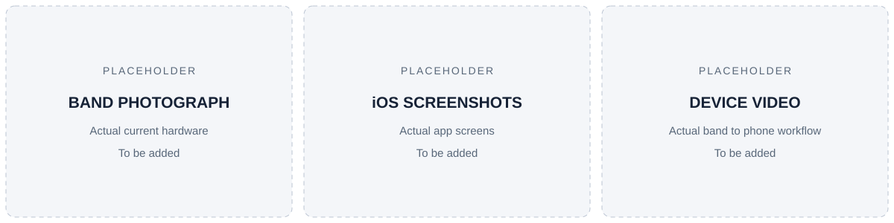
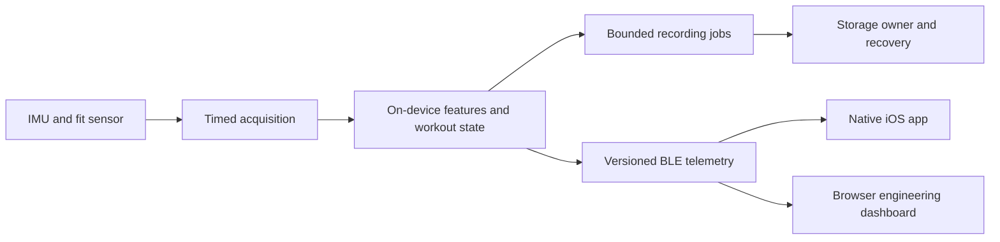

# Kyntex engineering portfolio

Kyntex is a wearable prototype that measures motion and band fit, processes
workouts on an nRF54L15 running Zephyr, and communicates with a native iOS app
and a browser engineering dashboard.

**Ben Harris - co-founder and sole engineer.** Engineering scope spans embedded
firmware, Bluetooth protocols, companion software, and hardware prototyping.
The project is in development; sensor-derived training metrics are not validated
measurements of joint force or injury risk.

[Start a five-minute review](docs/reviewer-guide.md) ·
[Run the public samples](#run-the-public-samples) ·
[See the evidence and limitations](docs/validation-status.md)

## See the system



**Visual evidence pending:** the panels above are explicitly labeled placeholders.
The runnable dashboard below uses synthetic signals and does not connect to a band.



The full device implementation is maintained privately. The C examples and
synthetic dashboard here are adapted public demonstrations with their own tests.

## Three engineering decisions to explore

| Engineering problem | Approach | Read the case study |
| --- | --- | --- |
| Keep workout recording independent of a phone connection | Separate acquisition, bounded recording jobs, and persistent storage; recover committed records after interruption | [Recording and recovery](docs/case-studies/recording-recovery.md) |
| Update firmware without bypassing workout or boot-health rules | Bind the intended image to an update window; gate operations on device state; confirm a test image after health checks | [Updates and boot health](docs/case-studies/updates-boot-health.md) |
| Convert sensor readings into consistent session behavior | Use explicit driver state, calibration, filtering, and confirmed session transitions | [Sensors and calibration](docs/case-studies/sensors-calibration.md) |

These pages describe implementation and verification. A separate
[personal debugging story](docs/case-studies/debugging-story.md) is a placeholder
until the author's investigation and measurements are documented.

## Explore by discipline

| Interest | Start here |
| --- | --- |
| Firmware and embedded C | [Sample guide](docs/firmware-samples.md), [C sources](firmware-core/src/), and [tests](firmware-core/tests/test_firmware.c) |
| System design and concurrency | [Architecture and execution contexts](docs/system-architecture.md) |
| Hardware | [Revision history and bring-up evidence](docs/hardware/README.md) |
| iOS and device integration | [Companion app case study](docs/ios-companion.md) |
| Browser software | [Synthetic dashboard](dashboard/) and [demo instructions](docs/demo.md) |
| Validation | [Dated results and remaining checks](docs/validation-status.md) |

## Run the public samples

The public C11 examples use no board or vendor SDK. With CMake and a C compiler:

```text
cmake -S firmware-core -B build/firmware
cmake --build build/firmware
ctest --test-dir build/firmware --output-on-failure
```

With Node.js 24 or later, check the JavaScript, dashboard tests, and documentation:

```text
npm test
npm run check:docs
```

For the browser demo, serve the repository with Python 3:

```text
python -m http.server 8000
```

Open `http://localhost:8000/dashboard/`. The synthetic demo illustrates charts,
bounded storage, history, and CSV/JSON export; it is not a physical-device test.

## Verification and development status

On October 29, 2026, the public C examples compiled and passed with GCC and all
seven dashboard regression tests passed. The development firmware's host suite
also passed, including simulated interrupted writes, recovery, reconnect handling,
profile admission, update policy, and build-gate checks. These are distinct suites.

The current firmware driver uses **timed IMU sampling**. Physical timing, power,
update/rollback, and session validation require separate device evidence.
History transfer is disabled by default pending owner authentication; signed
images do not by themselves establish authenticated device ownership.

[Verification details](docs/validation-status.md) ·
[Project scope](docs/project-overview.md) ·
[Development roadmap](docs/roadmap.md) ·
[Documentation index](docs/index.md)

## Public scope and terms

This repository contains selected public examples, architecture descriptions,
historical hardware references, and explicitly labeled placeholders. Current
device source, packet definitions, device calibration values, signing credentials,
and private recordings are excluded. [Sample provenance](docs/firmware-samples.md)
explains how the public examples differ from the band implementation.

Kyntex is not a medical device and is not intended to diagnose, treat, prevent,
or predict injury. Copyright and usage terms are in [LICENSE](LICENSE).
