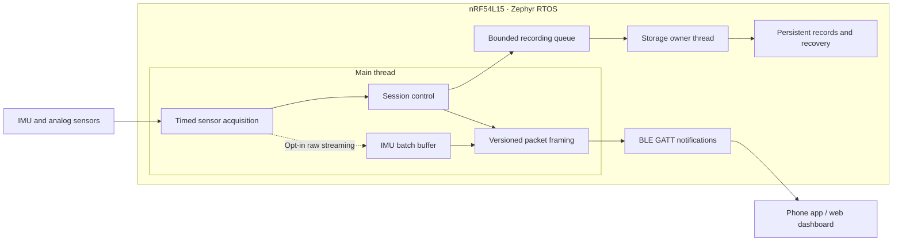

# Kyntex engineering portfolio

[](https://github.com/Kyntex-org/Kyntex-Technical-Public/actions/workflows/validate.yml)

An nRF54L15 wearable prototype with C firmware, Zephyr RTOS, a custom BLE protocol, and phone-independent recording.

**Built and maintained by Ben Harris**, co-founder, CTO, and sole engineer

## Engineering highlights

- **[Sensor integration](https://github.com/Kyntex-org/Kyntex-Technical-Public/blob/main/docs/case-studies/sensors-calibration.md):** register-level IMU driver supporting the board's LSM6DS3TR-C despite an SDK declaration mismatch.
- **[Recording and recovery](https://github.com/Kyntex-org/Kyntex-Technical-Public/blob/main/docs/case-studies/recording-recovery.md):** phone-independent recording, bounded storage jobs, recovery checkpoints, and nine host-simulated power-interruption sweeps.
- **[Firmware updates](https://github.com/Kyntex-org/Kyntex-Technical-Public/blob/main/docs/case-studies/updates-boot-health.md):** signed OTA update support through MCUboot, with device-state eligibility checks and health-gated boot confirmation.
- **[Custom hardware](https://github.com/Kyntex-org/Kyntex-Technical-Public/blob/main/docs/hardware/README.md):** NINA-B302/nRF52 PCB designed in KiCad, fabricated and brought up. Power and J-Link/SWD programming verified; mixed-signal sensor debugging continues.

[Start a five-minute review](https://github.com/Kyntex-org/Kyntex-Technical-Public/blob/main/docs/reviewer-guide.md) · [Architecture](https://github.com/Kyntex-org/Kyntex-Technical-Public/blob/main/docs/system-architecture.md) · [Company overview](https://github.com/Kyntex-org)

## See the system



IMU reads are paced by the main thread using elapsed uptime and sleeps. Raw streaming is opt-in. Recording continues without a connected phone, with persistent-storage work handed to a separate thread.

BLE packets carry checksums, boot/session identifiers, packet sequences, sample indices and dropped-sample accounting. These let receivers distinguish restarts and session boundaries from missing data. Gap and drop indications can overlap, so receivers must reconcile them rather than count the same loss twice. The metadata exposes loss; it does not reconstruct missing samples.

## Three engineering decisions to explore

| Engineering problem | Approach | Read the case study |
| --- | --- | --- |
| Keep workout recording independent of a phone connection | Separate acquisition, bounded recording jobs, and persistent storage; recover committed records after interruption | [Recording and recovery](https://github.com/Kyntex-org/Kyntex-Technical-Public/blob/main/docs/case-studies/recording-recovery.md) |
| Update firmware without bypassing workout or boot-health rules | Bind the intended image to an update window; gate operations on device state; confirm a test image after health checks | [Updates and boot health](https://github.com/Kyntex-org/Kyntex-Technical-Public/blob/main/docs/case-studies/updates-boot-health.md) |
| Convert sensor readings into consistent session behavior | Use explicit driver state, calibration, filtering, and confirmed session transitions | [Sensors and calibration](https://github.com/Kyntex-org/Kyntex-Technical-Public/blob/main/docs/case-studies/sensors-calibration.md) |

## Explore by discipline

| Interest | Start here |
| --- | --- |
| Firmware and embedded C | [Sample guide](https://github.com/Kyntex-org/Kyntex-Technical-Public/blob/main/docs/firmware-samples.md), [C sources](https://github.com/Kyntex-org/Kyntex-Technical-Public/blob/main/firmware-core/src/), and [tests](https://github.com/Kyntex-org/Kyntex-Technical-Public/blob/main/firmware-core/tests/test_firmware.c) |
| System design and concurrency | [Architecture and execution contexts](https://github.com/Kyntex-org/Kyntex-Technical-Public/blob/main/docs/system-architecture.md) |
| Hardware | [Revision history and bring-up evidence](https://github.com/Kyntex-org/Kyntex-Technical-Public/blob/main/docs/hardware/README.md) |
| Browser software | [Synthetic dashboard](https://github.com/Kyntex-org/Kyntex-Technical-Public/blob/main/dashboard/) and [demo instructions](https://github.com/Kyntex-org/Kyntex-Technical-Public/blob/main/docs/demo.md) |
| Validation | [Dated results and remaining checks](https://github.com/Kyntex-org/Kyntex-Technical-Public/blob/main/docs/validation-status.md) |

## Run the public samples

The public C11 examples use no board or vendor SDK. With CMake and a C compiler:

```text
cmake -S firmware-core -B build/firmware
cmake --build build/firmware
ctest --test-dir build/firmware --output-on-failure
```

With Node.js 24 or later, check the JavaScript, dashboard tests, and documentation:

```text
npm test
npm run check:docs
```

For the browser demo, serve the repository with Python 3:

```text
python -m http.server 8000
```

Open `http://localhost:8000/dashboard/`. The synthetic demo illustrates charts,
bounded storage, history, and CSV/JSON export; it is not a physical-device test.

## Verification and development status

On October 29, 2026, the public C examples compiled and passed with GCC and all
seven dashboard regression tests passed. The development firmware's host suite
also passed, including simulated interrupted writes, recovery, reconnect handling,
profile admission, update policy, and build-gate checks. These are distinct suites.

The current firmware driver uses **timed IMU sampling**. Physical timing, power,
update/rollback, and session validation require separate device evidence.
History transfer is disabled by default pending owner authentication; signed
images do not by themselves establish authenticated device ownership.

[Verification details](https://github.com/Kyntex-org/Kyntex-Technical-Public/blob/main/docs/validation-status.md) ·
[Project scope](https://github.com/Kyntex-org/Kyntex-Technical-Public/blob/main/docs/project-overview.md) ·
[Development roadmap](https://github.com/Kyntex-org/Kyntex-Technical-Public/blob/main/docs/roadmap.md) ·
[Documentation index](https://github.com/Kyntex-org/Kyntex-Technical-Public/blob/main/docs/index.md)

---

Current engineering work remains private to protect intellectual property; this page is a public snapshot. For more information, contact [kyntexsupport@gmail.com](mailto:kyntexsupport@gmail.com).

**Disclaimer:** This product is not a medical device and is not intended to diagnose, treat, cure, or prevent any disease or injury.
