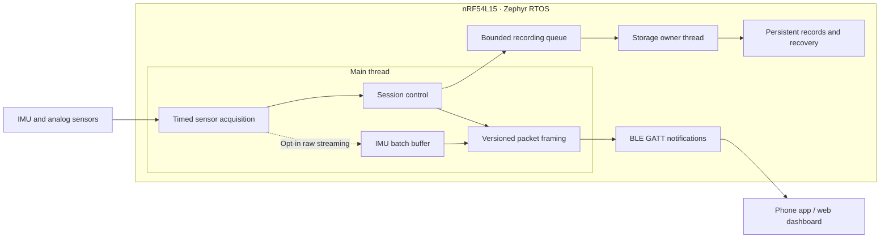

# Kyntex engineering portfolio

[](https://github.com/Kyntex-org/Kyntex-Technical-Public/actions/workflows/validate.yml)

An nRF54L15 wearable prototype with C firmware, Zephyr RTOS, a custom BLE protocol, and phone-independent recording.

**Built and maintained by Ben Harris**, co-founder, CTO, and sole engineer

## Engineering highlights

- **Scale:** ~13,000 lines of C source and headers, with 86 host tests across core firmware suites plus nine storage recovery sweeps.
- **[Sensor integration](https://github.com/Kyntex-org/Kyntex-Technical-Public/blob/main/docs/case-studies/sensors-calibration.md):** custom IMU driver for the board's LSM6DS3TR-C, which the SDK incorrectly declares as an LSM6DSO.
- **[Recording and recovery](https://github.com/Kyntex-org/Kyntex-Technical-Public/blob/main/docs/case-studies/recording-recovery.md):** phone-independent recording and nine fault-injection sweeps that simulate power loss during writes and erases, restart the store, and verify recovery.
- **[Firmware updates](https://github.com/Kyntex-org/Kyntex-Technical-Public/blob/main/docs/case-studies/updates-boot-health.md):** published three signed firmware images, versions 1.6.0–1.6.2, with MCUboot update support, device-state eligibility checks, and health-gated boot confirmation.
- **[Custom hardware](https://github.com/Kyntex-org/Kyntex-Technical-Public/blob/main/docs/hardware/README.md):** NINA-B302/nRF52 PCB designed in KiCad, fabricated and brought up. Power and J-Link/SWD programming verified; mixed-signal sensor debugging continues.

[Start a five-minute review](https://github.com/Kyntex-org/Kyntex-Technical-Public/blob/main/docs/reviewer-guide.md) · [Architecture](https://github.com/Kyntex-org/Kyntex-Technical-Public/blob/main/docs/system-architecture.md) · [Company overview](https://github.com/Kyntex-org)

## See the system



IMU reads are paced by the main thread using elapsed uptime and sleeps. Versioned BLE packets include checksums and sequence/drop counters so receivers can detect missing data.

## Explore by discipline

| Interest | Start here |
| --- | --- |
| Firmware and embedded C | [Sample guide](https://github.com/Kyntex-org/Kyntex-Technical-Public/blob/main/docs/firmware-samples.md), [C sources](https://github.com/Kyntex-org/Kyntex-Technical-Public/blob/main/firmware-core/src/), and [tests](https://github.com/Kyntex-org/Kyntex-Technical-Public/blob/main/firmware-core/tests/test_firmware.c) |
| System design and concurrency | [Architecture and execution contexts](https://github.com/Kyntex-org/Kyntex-Technical-Public/blob/main/docs/system-architecture.md) |
| Hardware | [Revision history and bring-up evidence](https://github.com/Kyntex-org/Kyntex-Technical-Public/blob/main/docs/hardware/README.md) |
| Browser software | [Synthetic dashboard](https://github.com/Kyntex-org/Kyntex-Technical-Public/blob/main/dashboard/) and [demo instructions](https://github.com/Kyntex-org/Kyntex-Technical-Public/blob/main/docs/demo.md) |
| Validation | [Dated results and remaining checks](https://github.com/Kyntex-org/Kyntex-Technical-Public/blob/main/docs/validation-status.md) |

## Run the public samples

The public C11 examples use no board or vendor SDK. With CMake and a C compiler:

```text
cmake -S firmware-core -B build/firmware
cmake --build build/firmware
ctest --test-dir build/firmware --output-on-failure
```

With Node.js 24 or later, check the JavaScript, dashboard tests, and documentation:

```text
npm test
npm run check:docs
```

For the browser demo, serve the repository with Python 3:

```text
python -m http.server 8000
```

Open `http://localhost:8000/dashboard/`. The synthetic demo illustrates charts,
bounded storage, history, and CSV/JSON export; it is not a physical-device test.

See [Testing and validation](https://github.com/Kyntex-org/Kyntex-Technical-Public/blob/main/docs/validation-status.md) for CI coverage, firmware host tests, and ongoing device validation.

---

Current engineering work remains private to protect intellectual property; this page is a public snapshot. For more information, contact [kyntexsupport@gmail.com](mailto:kyntexsupport@gmail.com).

**Disclaimer:** This product is not a medical device and is not intended to diagnose, treat, cure, or prevent any disease or injury.
