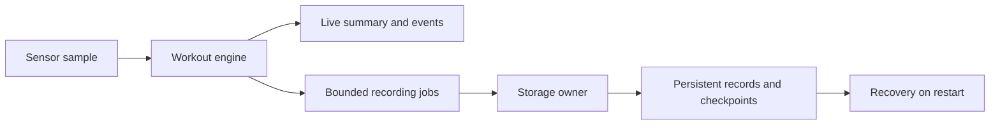

# Recording independently of Bluetooth

## Requirement and constraints

A workout should not stop because the phone disconnects. The band also has
finite memory and persistent storage, so the design must distinguish continued
live sensing, retained totals, retained timeline detail, and data that was never
durably committed.

## Implementation approach

I hand off recording work before the optional raw-stream gate, so recording does not depend on a connected phone or raw streaming. Flash work belongs to a separate storage thread. Bounded jobs and retry
queues protect the sensing path from unbounded memory growth. Lifecycle work
receives reserved capacity; detail can be reduced and counted when pressure
exceeds what the store can accept.

Stored records are versioned and checked for integrity. Mount scans for
unsupported valid schemas before making recovery writes. Acknowledgement and
reclamation are separate: a retained unacknowledged workout is not silently
overwritten. Checkpoints support recovery of committed totals after interruption.

## Tradeoffs

Writing every raw sample would demand a different capacity and power budget.
The on-band store instead keeps aggregate totals, timeline bins, and recovery
checkpoints. Reducing timeline detail extends useful recording capacity, while
quality metadata makes that reduction visible. Checkpointed recovery can lose
the most recent uncommitted interval; it is not a blanket lossless guarantee.

Moving storage to a lower-priority owner is intended to limit interference with
sampling. Real driver latency and interrupt masking still determine the
physical worst case and must be measured on the target.

## Verification

My storage host suite passed 28 cases on October 29, 2026, covering recovery, simulated interrupted writes, full-store behavior, bounded retries, reconnects and recording with raw streaming disabled. I use simulated media for these tests; physical storage timing, endurance and power need device measurements.

I also run nine host-simulated power-interruption sweeps across configuration changes, recording, reclamation and metadata repair. The sweeps inject interruptions at simulated write/erase boundaries, restart the store, and check record consistency.

History-transfer control remains disabled by default pending owner
authentication. Host transfer tests and engineering-only paths must not be
presented as a released authenticated product feature.

## Public material to inspect

The [session example](../../firmware-core/src/band_session.c) illustrates timing
and state boundaries; the [telemetry example](../../firmware-core/src/telemetry.c)
illustrates gap accounting. Neither contains the full persistent store.
See [sample differences](../firmware-samples.md) and [dated evidence](../validation-status.md).

For a discussion, trace one workout through start, disconnection, full storage,
checkpoint, reset, and recovery. State which quantities remain exact and which
become partial or approximate.
