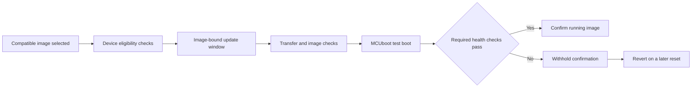

# Firmware updates and boot health

## Requirement and constraints

A signed firmware image still needs a controlled installation lifecycle.
The band should not accept disruptive update operations during a workout or
confirm a newly booted image before its required subsystems work.

## Implementation approach

The update window binds the intended image's identity and size to the request.
Management-operation policy checks workout state, battery validity/freshness,
and the current image's confirmation state. Transfer and image-state operations
are checked at the management boundary rather than relying only on an app UI.

MCUboot verifies the image signature. After a test boot, application health
checks own confirmation; a client must not bypass that decision by permanently
marking an image. A failed subsystem keeps confirmation pending, with recovery
behavior considered separately from a normal update.

## Tradeoffs

Confirming immediately after boot is simpler but can make a broken image
permanent. Health-gated confirmation adds state and recovery cases. Withholding
confirmation is not the same as an automatic reset: the reviewed policy can
remain unconfirmed until a later reset. Persistent sensor-failure policy and
physical recovery behavior still need validation.

Image authenticity, transfer integrity, application eligibility, and ownership
authorization are different properties. Signed images do not establish who may
control a device. Production owner authentication remains unfinished.

## Verification

The October 29, 2026 host run passed 30 combined boot-health, management-policy,
and update-contract tests plus shared update vectors. Covered cases include
unknown/stale battery, active workouts, wrong-image binding, transfer completion,
reconnects, timeout, and refusal to bypass boot confirmation.

The review did not flash a band, repeat a full SDK build, or physically test
interrupted transfer and rollback. Existing published firmware artifacts were
not changed or requalified by the portfolio update.

## Public material to inspect

Read the [architecture](../system-architecture.md) and
[validation table](../validation-status.md). Full update implementation,
device-specific commands, signing configuration, and keys are excluded from
the public samples. A useful interview walkthrough follows a successful
update and then repeats it with one failed boot-health check.
