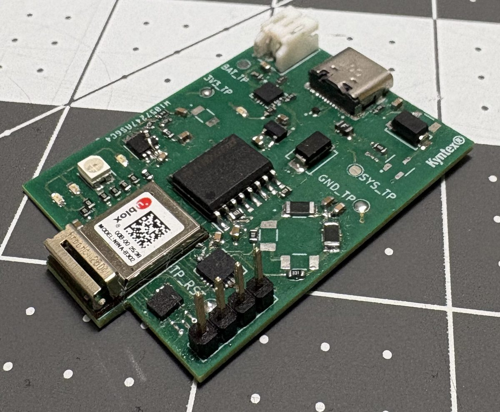

# Hardware revisions and bring-up

Ben Harris is co-founder, CTO, and sole engineer. The current development platform and earlier custom PCB are separate hardware revisions.

| Revision | Contribution and status |
| --- | --- |
| Current XIAO nRF54L15 Sense prototype | C firmware and Zephyr integration, onboard IMU, analog sensing and battery monitoring; programmed through the onboard CMSIS-DAP probe. |
| Earlier custom NINA-B302/nRF52 PCB | Designed in KiCad, fabricated and brought up; power delivery and J-Link/SWD programming verified, with mixed-signal sensor-interface debugging in progress. |
| Earlier ESP32 prototype | Historical sensing and hardware exploration. |

*The earlier custom NINA-B302/nRF52 PCB, assembled.*

The current firmware runs on the XIAO board. The J-Link/SWD bring-up work belongs to the earlier custom NINA-B302 board.

Physical timing, power and sensor measurements are in progress; see [validation status](../validation-status.md).

[Sensors and calibration](../case-studies/sensors-calibration.md) · [Technical roadmap](../roadmap.md) · [Portfolio](../../README.md)
