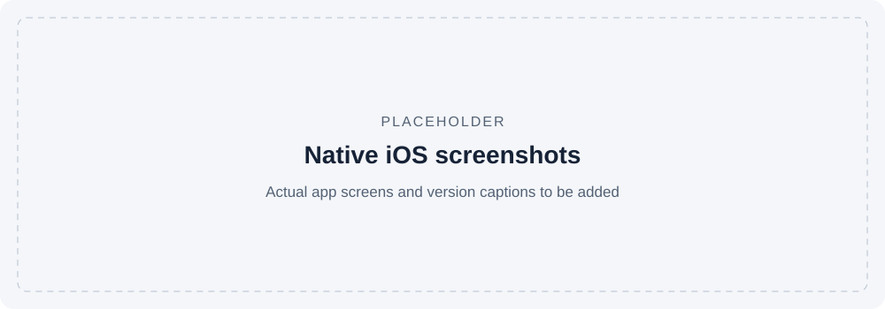

# Native iOS companion

The SwiftUI/CoreBluetooth app is the consumer-facing companion to the band.
The browser engineering dashboard and public synthetic dashboard serve different
purposes. The full iOS source remains private.

## Experience

The development app includes setup, athlete profiles and guided personal
calibration, workout controls, live summaries, recaps, local history, and an
ActivityKit Live Activity. The current experience is local-first and does not
require a Kyntex account. Cloud sync, coach sharing, and subscriptions are not
presented as implemented capabilities here.

**Screenshot placeholder:** replace with actual development-app screens and
identify the app/firmware versions and whether the data is synthetic.

## Responsibilities across the device boundary

| Concern | App responsibility | Device responsibility |
| --- | --- | --- |
| Profile and calibration | Select the athlete; send configuration and confirm readback | Store and apply the matching configuration before starting |
| Pause/resume | Show pending state until delivery and matching telemetry confirm application | Apply session state and keep manual pause distinct from automatic rest |
| Reconnect | Reconcile session identity and actual device state | Keep sensing/session behavior independent of the phone link |
| Updates | Identify a compatible offer and coordinate transfer | Enforce update policy and own boot-health confirmation |
| Presentation | Explain training proxies and visible data quality | Supply versioned state and integrity information |

An acknowledgement of a write is not automatically proof that every requested
state change has been applied. Explicit readback/telemetry makes the distinction
visible. Workouts, profiles, and calibration need consistent identity across
reconnects; raw streaming is an optional calibration/engineering path rather
than a requirement for every normal workout.

## Evidence boundary

The October 29 portfolio review ran firmware host tests and public sample tests;
it did not repeat the iOS test/build or a physical phone-to-band session.
Earlier Mac test counts remain historical reports on the
[validation page](validation-status.md). Screenshots alone will demonstrate UI,
not sensor accuracy or physical update reliability.

Training-load and impact scores are personalized engineering proxies, not direct
joint-force or injury-risk measurements. Native source, device identifiers,
calibration internals, and real user recordings are excluded from this portfolio.
