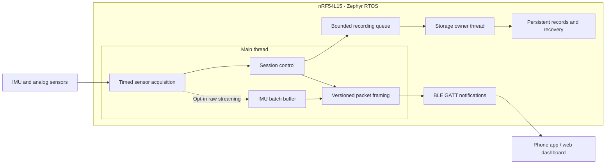

# System architecture

I run C firmware on an nRF54L15 with Zephyr RTOS. I keep sensor acquisition and session control in the main thread, then hand recording work to a separate storage thread. The diagram matches the [portfolio README](../README.md).

## Execution contexts

| Context | Responsibility | Design constraint |
| --- | --- | --- |
| Main thread | Timed sensor reads, session control, packet preparation and recording handoff | Keep long storage operations out of acquisition; other loop work and scheduling can still delay reads. |
| Bluetooth callbacks | Validate and hand off requests; track the connection | Keep work bounded and do not deliver delayed responses to a replacement connection. |
| Storage owner thread | Execute bounded recording jobs, checkpoints and recovery | Queue capacity and physical driver latency remain finite. |
| Deferred battery work | Allow the measurement circuit to settle before the main thread completes the ADC read | Avoid a blocking settling delay in the sampling path. |

## Acquisition and streaming

IMU reads are paced by the main thread. It checks elapsed uptime against the configured sample period, sleeps between checks, then reads over I2C when due. It does not use a sensor interrupt or an application timer callback to initiate acquisition. Failed reads and missed sampling periods contribute to data-quality accounting.

The firmware also services analog fit sensing and battery monitoring. Raw IMU streaming is opt-in for engineering capture; normal workout recording does not require it.

Versioned packets carry checksums and integrity metadata. Boot/session identifiers, packet sequences, sample indices and drop counters help receivers distinguish restarts, recording boundaries and missing data. Overlapping gap and drop indications must not be counted twice. These fields expose loss rather than reconstruct missing samples.

## Recording and recovery

Recording work is handed off before the optional raw-stream gate, so recording does not depend on raw streaming or a connected phone. A bounded queue separates the main thread from the storage owner. Persistent records and checkpoints support recovery of committed state after interruption.

I give the storage thread lower priority than the sampling context to limit interference with acquisition. I still need hardware measurements for worst-case latency, flash operations and stack headroom.

History transfer is disabled by default pending owner authentication. Engineering-only test paths do not establish released, authenticated device access.

## Clients and firmware updates

Data streams over BLE to a native iOS app and a web dashboard. The [public synthetic dashboard](demo.md) is a separate hardware-free demonstration and cannot connect to a band.

MCUboot verifies signed images. Application policy controls update eligibility, and boot-health checks determine whether a test image may be confirmed. See [updates and boot health](case-studies/updates-boot-health.md).

[Recording and recovery](case-studies/recording-recovery.md) · [Sensors and calibration](case-studies/sensors-calibration.md) · [Validation evidence](validation-status.md)
