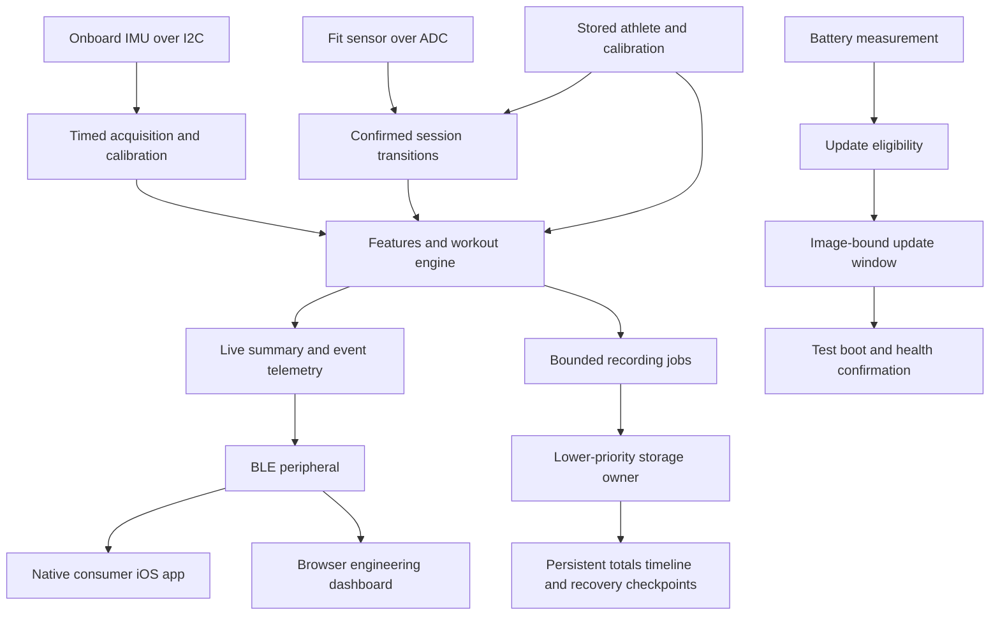

# System architecture

This describes the device architecture reviewed on October 29, 2026. The
[public code](firmware-samples.md) demonstrates selected concepts, with different
interfaces and configuration from the full implementation.

## Execution contexts

| Context | Responsibility | Design constraint |
| --- | --- | --- |
| Main sensing/control loop | Timed IMU reads, fit/session state, engine updates, and live packets | Avoid long storage operations in the acquisition path |
| Bluetooth callbacks | Validate and hand off requests; maintain connection identity | A delayed response must not be delivered to a replacement connection |
| Storage owner thread | Execute recording jobs, checkpoints, recovery, and permitted history requests | Bound queues and protect lifecycle work under pressure |
| Deferred battery work | Wait for the measurement divider to settle, then let the main loop complete the read | Avoid a blocking settle delay in the sampling path |

The storage owner runs below the sampling context in priority. This is a design
to protect sampling, not proof of a particular worst-case latency: target-driver
behavior, stack headroom, and physical timing still need measurement.

## Acquisition and processing

The current IMU driver uses **timed sampling**, direct I2C register access,
explicit power-state tracking, and missed-sample accounting. It does not install
a data-ready interrupt callback in the reviewed implementation. Calibration
corrects gyro offset and static acceleration magnitude without assuming the
band's mounting axis is vertical. The engine uses filtered data; optional raw
capture uses calibrated, unfiltered values.

Fixed-duration feature windows, hysteresis, and timing rules support explainable
movement and impact summaries. The validity of a health or biomechanical claim
cannot be inferred from these algorithms alone.

## Recording and Bluetooth

Recording does not depend on a raw stream or a connected phone. A bounded queue
hands jobs to persistent storage; explicit quality flags account for reduced
detail and failures. Recovery checkpoints constrain what survives interruption.
Unacknowledged stored workouts are not silently replaced to make space.

Live telemetry and stored data carry identity and version information. The full
clients support current nRF54 telemetry generations; retired Arduino telemetry
is rejected. The separate public packet example is not the device wire format.

History transfer is disabled by default until owner authentication is implemented.
Engineering-only test paths do not constitute production authenticated access.

## Client roles and updates

The native iOS app is the consumer surface. The browser dashboard is an
engineering tool. The [public dashboard](demo.md) is a third, synthetic-data
demonstration and cannot connect to a band.

MCUboot handles signed-image verification. Application update policy and
boot-health checks control when update actions and image confirmation are
allowed. See [updates and boot health](case-studies/updates-boot-health.md).

[Recording case study](case-studies/recording-recovery.md) ·
[Sensor case study](case-studies/sensors-calibration.md) ·
[Verification](validation-status.md)
